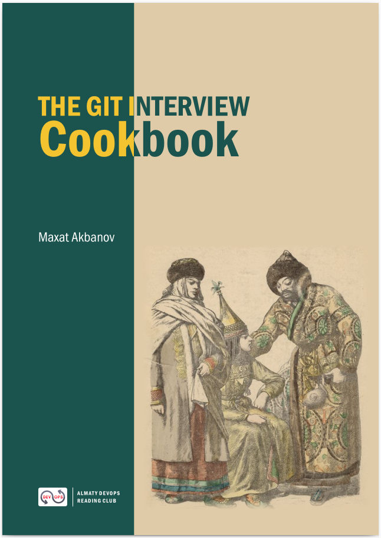

# the-git-interview-cookbook

Official code repository for "Git Interview Cookbook" by Maxat Akbanov

## Table of contents
1. Chapter 1: Core Git Concepts
    - [Exercise: SVN Basics in Practice](./chapter-1/svn-basics/)

## Sign Up

Join the **Almaty DevOps Reading Club** Telegram channel to stay updated on new chapters, exercises, and discussions:

👉 [t.me/devops_orbit](https://t.me/devops_orbit)
